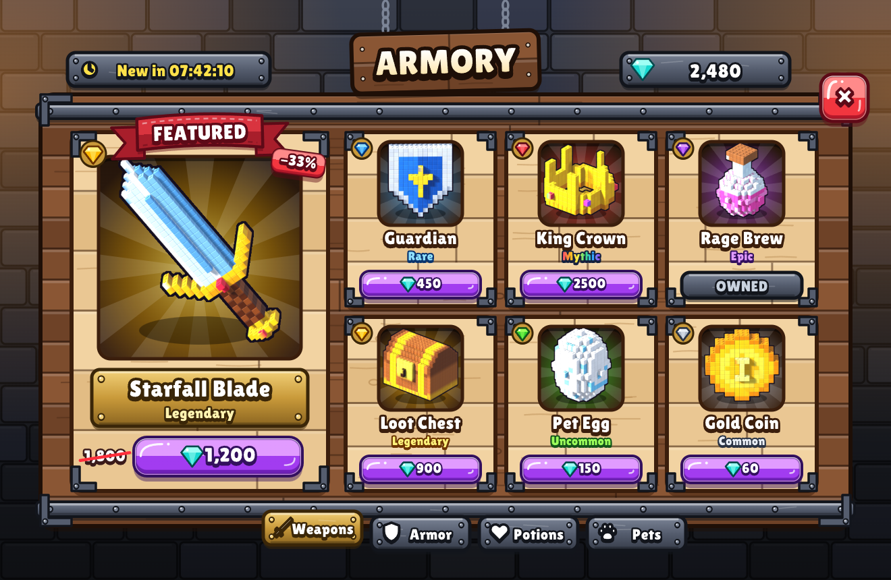
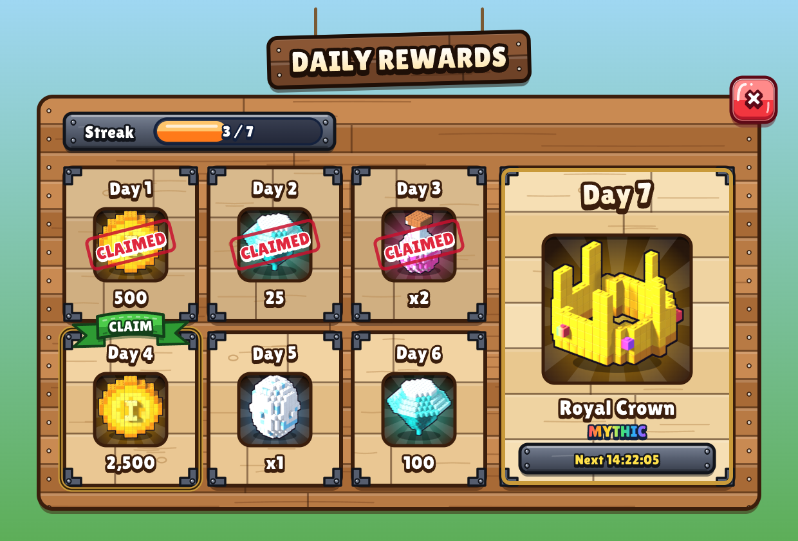

# AI Roblox Tools

Tools and skills that let AI agents build Roblox games properly. First tool: **Roblox UI Craft**.

An AI agent skill (Claude Code and compatible agents) for making **Roblox game UI that looks like the big games**: shops, egg screens, season passes, daily rewards, offers, tabs. Plus the icons that go in them, and how to ship it all into Roblox Studio.


## What's inside
- **Two proven styles**: *Roblox-flat* (studied from top simulators: thick black outlines, value ribbons, lime buy buttons) and *Material* (wood, iron, cloth, stone).
- **7 finished example screens** as code you can copy: egg/gacha, restock seed stall, armory, season pass, starter offer, daily rewards, egg hatchery.
- **Python SVG kit** that renders real PNG mockups (no design app needed).
- **Icon guidance**: where good icons come from, what makes them look professional, plus a Blender **toon icon recipe** and sample renders.
- **Figma and FigCraft** workflows for editing mockups by hand.
- **Placement guide**: where every UI element goes on phone, PC and console (safe insets, thumbstick and jump zones, ScreenGui layers).
- **Rules for AI agents**: where things go in the Explorer, small scripts, real UI instances, secure purchases.
- **AnimKit** (experimental): a declarative animation builder for Studio.

| | |
|---|---|
|  |  |
|  |  |

## Install
```bash
git clone https://github.com/Nomako20/ai-roblox-tools ~/.claude/skills/ai-roblox-tools
pip install fonttools pillow playwright
```
Rendering uses your installed Edge or Chrome through Playwright, so there's no browser download. Blender 4+ is only needed to make new 3D icons.

## Use
Ask your agent things like:
- "Make a shop for my pet simulator, style like Pet Sim, sections for eggs, boosts, cash packs, gamepasses"
- "Egg screen for a lava egg with 6 pets and odds"
- "Seed shop UI that looks like a market stall"
- "Where should my HUD buttons go on mobile?"

Send it 2-4 screenshots of big games you like for best results. Full walkthrough: [GUIDE.md](GUIDE.md).

## Honest limits
The skill encodes the rules and the recipes. Getting from "good" to "top game" still takes a person looking at the result and pointing at what's off. Mockups are PNGs: shipping to Studio follows `references/roblox-pipeline.md`.

## Credits
Made by **Nomako20** with Claude. See [CREDITS.md](CREDITS.md). All rights reserved: see [LICENSE](LICENSE) (free to use in your own games, not to redistribute or resell).
