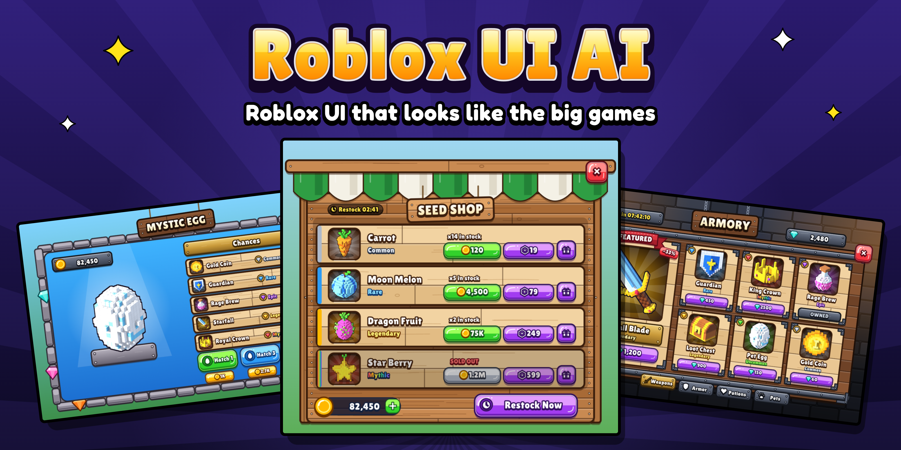
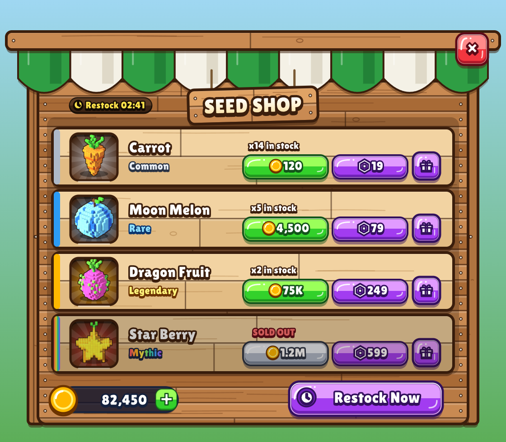
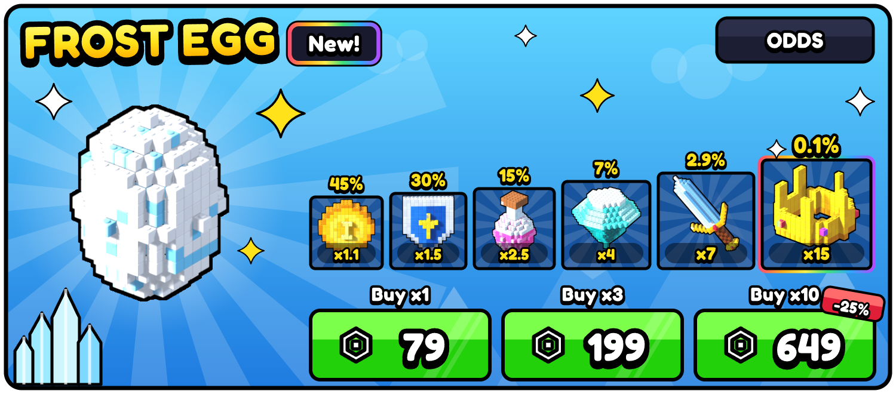
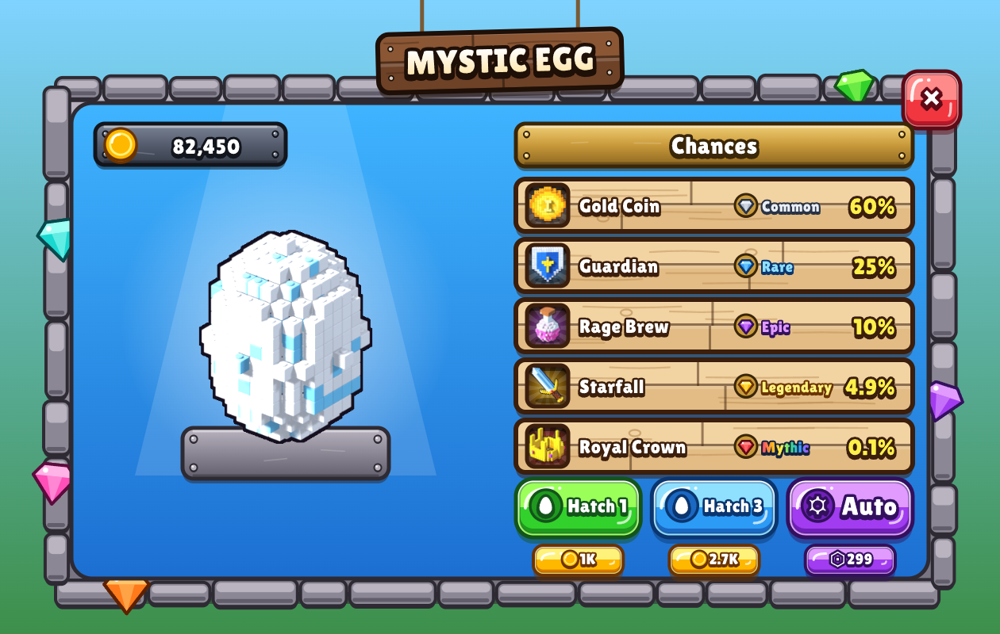
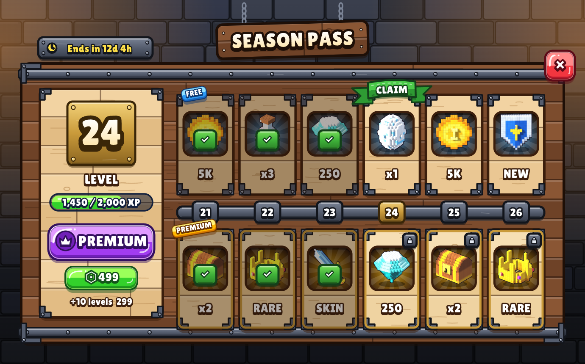
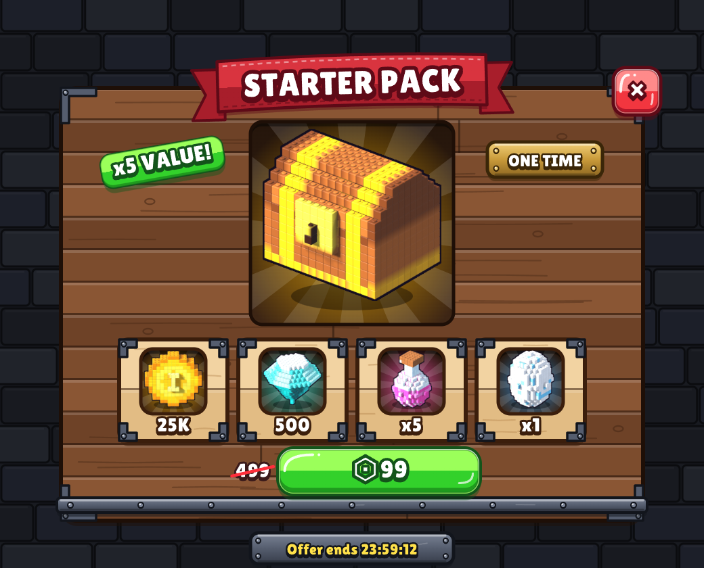
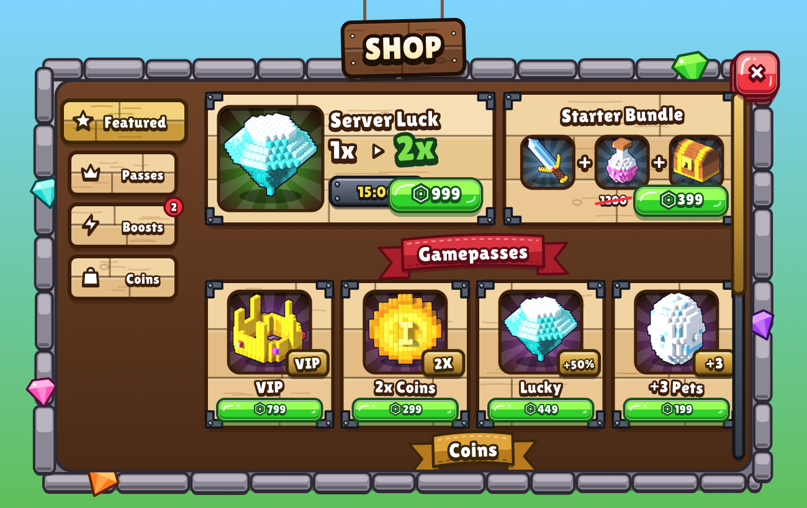

<p align="center"></p>

<p align="center"><b>A skill that teaches AI agents (Claude Code and similar) to make Roblox UI that looks like the big games,<br>and to understand how successful Roblox games are built.</b></p>

<p align="center">


</p>

## What it gives your agent
| | |
|---|---|
| **Big-game look** | Two proven styles: *Roblox-flat* (thick black outlines, value ribbons, lime buy buttons) and *Material* (wood, iron, cloth, stone) |
| **Real mockups** | A Python kit that renders finished PNG screens, no design app needed |
| **Screen library** | Restock shop, item shop, egg/gacha with odds, season pass, starter offer, daily rewards |
| **Placement** | Where every element goes on phone, PC and console |
| **Roblox strategy** | How discovery, retention and monetization work, and how to design for them |
| **Studio rules** | Where things go in the Explorer, short scripts, secure purchases, shipping UI as real instances |
| **Icons** | Blender toon/voxel recipes and where good icons come from |
| **Figma / FigCraft** | Editing and handing off mockups by hand |

<p align="center">


</p>

## Install
**Claude Code plugin (one command):**
```
/plugin marketplace add Nomako20/ai-roblox-tools
/plugin install ai-roblox-tools@ai-roblox-tools
```
**Or as a plain skill:**
```bash
git clone https://github.com/Nomako20/ai-roblox-tools ~/.claude/skills/ai-roblox-tools
```
For rendering mockups: `pip install fonttools pillow playwright`.
Rendering uses your installed Edge or Chrome, so no browser download. Blender 4+ is only needed for new 3D icons.

## Use
Ask your agent things like:
- "Make a seed shop for my garden game that looks like a market stall"
- "Egg screen for a lava egg with 6 pets and odds"
- "Plan the shop and gamepasses for my simulator"
- "Why are my players leaving after 5 minutes?"
- "Where should my HUD buttons go on mobile?"

Send 2-4 screenshots of big games you like for the best results. Walkthrough: [GUIDE.md](GUIDE.md).

## More examples
<p align="center">




</p>

## Honest limits
The skill gives the agent the rules, recipes and examples. Going from "good" to "top game" still takes a person looking at the result and pointing at what's off.

## Credits and license
Made by **Nomako20**. See [CREDITS.md](CREDITS.md). License: [CC BY-NC 4.0](LICENSE): change and share it with credit, don't sell it. What you build with it is yours.
